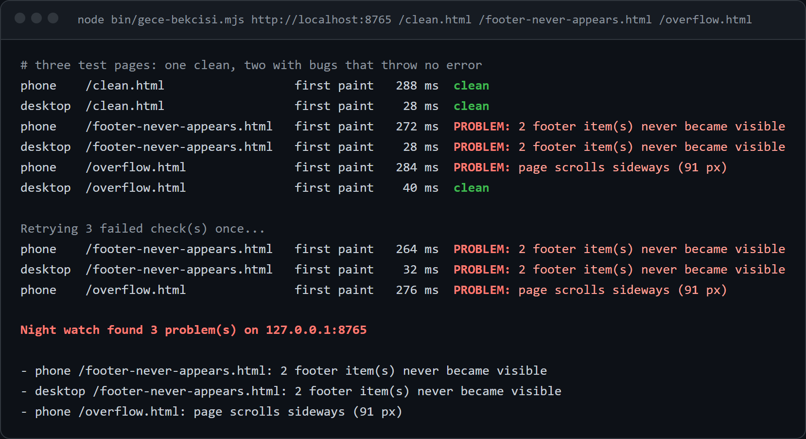

# gece-bekcisi

[](https://github.com/kerem-aydin/gece-bekcisi/actions/workflows/test.yml) 

*Gece bekçisi* means *night watchman*.

Every night a real browser opens your site as a slow phone and as a desktop,
scrolls every page to the bottom like a person would, and reports what broke
**without an error**: a section that never appears, a page that scrolls
sideways, a broken image, a page that got slow. Before it watches, it puts a
known bug back on purpose, and it fails if it cannot catch it.



## Why it exists

The footer of my own site was blank on phones. No error, no failing test, a
green deploy. A layout change after load had pushed the scroll trigger of the
footer animation *below the end of the page*, so it could never scroll into
view. On a laptop everything looked fine.

Unit tests check the code. Nothing was checking what a phone actually shows.
This tool does, every night, and it has to prove each time that it still can.

## What it catches

| Problem | How |
|---|---|
| Section or footer that never becomes visible | After scrolling to the bottom, text that is still `opacity: 0` or `visibility: hidden` |
| Sideways scroll on phones | Page width compared to the **device** width (a mobile browser zooms out to fit wide content, so `innerWidth` hides the bug) |
| Broken images | Loaded images with zero natural width |
| Page did not open, painted nothing, got slow | HTTP status, first contentful paint on a 4× throttled CPU and a 4G connection |
| JavaScript and server errors | Page errors, console errors, 5xx responses; analytics and favicon noise filtered out |

One-off network hiccups do not wake anyone up: failing checks are retried once
and only reported if they fail again.

## The self-test

A watch that silently stops watching is worse than no watch. With
`--sabotage`, the original bug (an invisible footer) is injected into the page
before it loads. The nightly job runs this first and **fails if the watch does
not report it**. Only then does the real check run.

The test suite does the same with small pages that reproduce real bugs, in a
real browser, on every push:

```
✔ clean page is clean on phone and desktop
✔ footer whose scroll trigger sits below the page never appears
✔ sideways scroll on a phone only
✔ broken image
✔ self-test: the known bug, put back on purpose, is caught
```

## Use it

```bash
npm ci
node bin/gece-bekcisi.mjs https://your-site.com / /pricing /contact --dry
```

```
phone    /            first paint  1696 ms  clean
desktop  /            first paint   732 ms  clean
phone    /pricing     first paint  1248 ms  clean
desktop  /pricing     first paint   460 ms  clean

Night watch: 2 page(s) on your-site.com are clean on phone and desktop.
```

Exit code is `0` when clean and `1` when something is broken, so it fits any
scheduler. Without `--dry`, problems go to Telegram if `TELEGRAM_BOT_TOKEN` and
`TELEGRAM_CHAT_ID` are set. A clean night stays quiet.

To run it every night on GitHub Actions, copy
[`examples/nightly.yml`](examples/nightly.yml) into your repository.

Needs Node 18+ and Google Chrome (`CHROME_PATH` if it is not in the usual
place). The only dependency is `puppeteer-core`.

## Layout

```
bin/gece-bekcisi.mjs   command line: pages × devices, retry, report
src/watch.js           the browser part: throttle, scroll, measure
src/report.js          pure rules: thresholds, noise, report text (unit tested)
test/site/             small pages that reproduce real bugs
```

MIT · [Kerem Aydın](https://github.com/kerem-aydin)
